# MTR DB Migration: step-by-step logic

This project has two parts:

| Part | Folder | What it does |
|:-:|---|---|---|
| **A. Database consolidation** | `consolidation/` | Merges the 9 `cwp*` PostgreSQL databases into one new database, `MtrMigration_Consolidated`. |
| **B. Metadata Horizontal** | `metadata_horizontal/` | Uploads a CSV/XLSX of metadata. Fixed fields go into one row per file; all other fields stay in the vertical `Metadata` table. |

An interactive version of this page is in [`migration_logic.html`](migration_logic.html). The icons and pictures in `img/` are produced from that page by `node export_images.js`.

---

## Part A: Database consolidation

### A.1 Overview

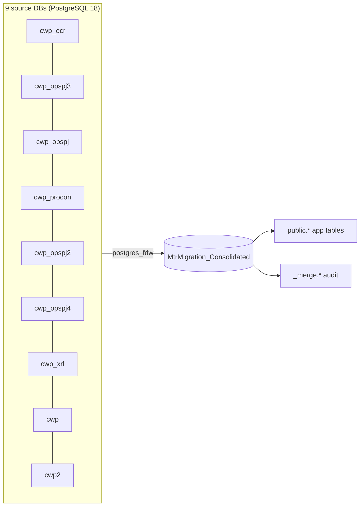

The sources are listed in **priority order**. When two databases hold the same record, the one higher in this list wins. The order is set in `consolidation/sources.json`.

### A.2 The steps

|  | # | Step | File | What happens |
|:-:|---|---|---|---|
|  | 1 | generate | `generate.py` | Reads `sources.json` and the 9 schema dumps, then writes the SQL for steps 1, 2, 3, 5 and 6. It stops with an error if any source column has no place in the target, so data can't be lost silently. |
|  | 2 | create | (runner) | `CREATE DATABASE MtrMigration_Consolidated`. It refuses to overwrite an existing database unless `-DropExistingTarget` is given. |
|  | 3 | schema | `sql/00_target_schema.sql` | Creates the superset schema (based on opspj4): 25 tables plus `Sites`, with PKs, unique constraints, functions and the `_merge` audit schema. |
|  | 4 | attach | `sql/01_attach_sources.sql` | Links each source through `postgres_fdw` as schema `src_<name>`. Nothing is copied yet. |
|  | 5 | preflight | `sql/02_preflight.sql` | **Read-only** report: row counts, sites that appear in more than one DB, key overlaps, and whether the new IDs fit in `integer`. The runner waits for you to confirm before continuing. |
|  | 6 | merge | `sql/03_merge.sql` | Copies every table from every source in **one transaction**, applying the ID, conflict and SiteId rules below. |
|  | 7 | finalize | `sql/04_finalize.sql` | Adds 73 secondary indexes, the foreign keys, the `SiteId` index/FK/trigger on 13 tables and `v_MigrationSummary`, then resets the sequences. |
|  | 8 | verify | `sql/05_verify.sql` | Every source row must be either loaded or recorded in `_merge.conflict_log`, and every `SiteId` must match its `SiteName`. If not, the step **fails**. |
|  | 9 | detach | `sql/06_detach_sources.sql` | Removes the fdw links. The `_merge` audit schema is kept. |


#### Step pictures

**A1. Generate: write the SQL from sources.json and the 9 dumps**

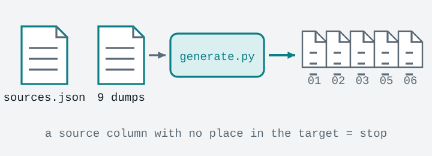

**A2. Create: a new, empty target database**

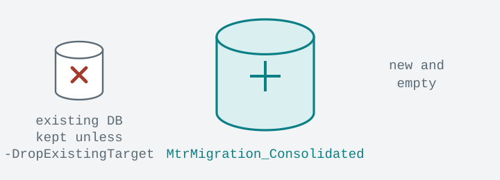

**A3. Schema: one superset of every table and column**

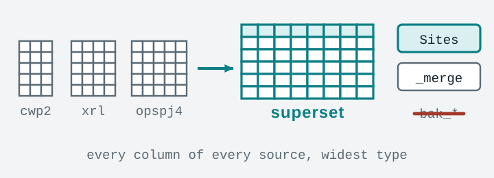

**A4. Attach: read the sources live through postgres_fdw**

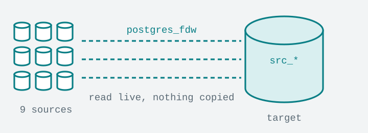

**A5. Preflight: read-only report, then you decide**

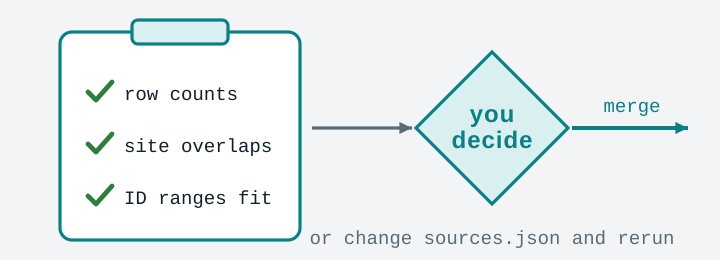

**A6. Merge: all sources into one database in one transaction**

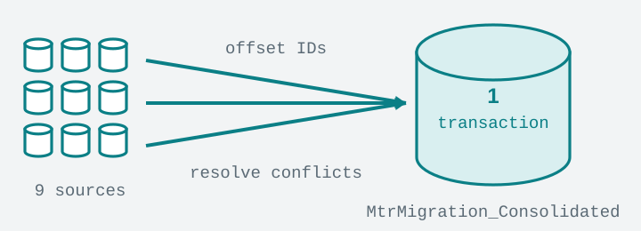

**A7. Finalize: indexes, foreign keys, SiteId, sequences**

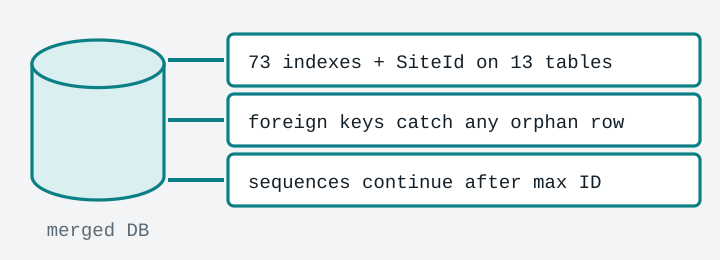

**A8. Verify: every source row is loaded or logged**

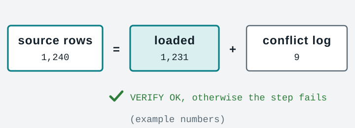

**A9. Detach: remove the links and point the GUI at the new DB**

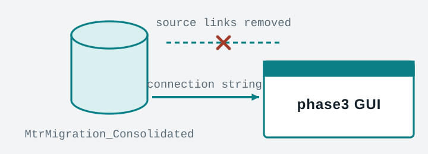

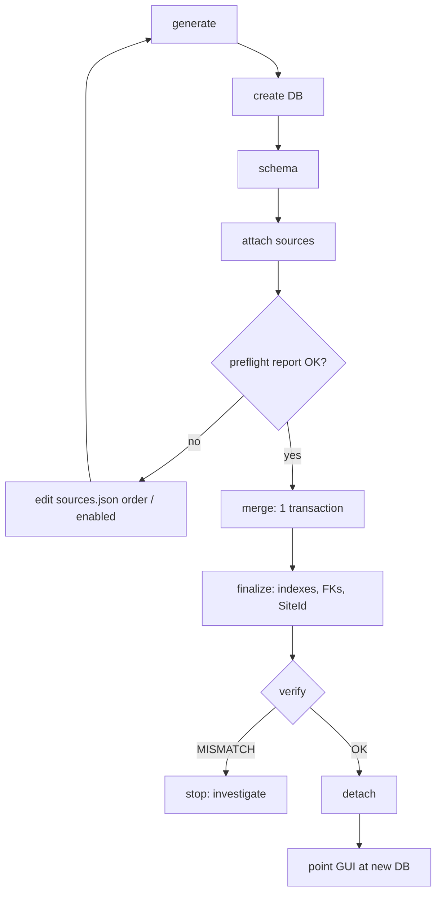

### A.3 Logic 1: renumbering IDs

Every source numbers its IDs from 1, so the IDs collide when merged. Each source gets an **offset** for each ID domain:

```
new_id = old_id + offset
offset(source k) = max_id(source 1) + ... + max_id(source k-1)
```

*Example numbers:*

| Source | max FileId | offset | new FileId range |
|---|---|---|---|
| cwp_ecr | 120,000 | 0 | 1 – 120,000 |
| cwp_opspj3 | 85,000 | 120,000 | 120,001 – 205,000 |
| cwp_opspj | 240,000 | 205,000 | 205,001 – 445,000 |
| … | … | … | … |

The real numbers are in `_merge.id_offset` after the merge, and preflight section H shows them before it. `max_id` is the highest value of that ID found anywhere in the source, including links with no foreign key, so a dangling ID can't collide with the next source's range.

- **Every linked column is shifted by the same offset.** For example, `Metadata.FileId`, `Permissions.FileId`, `MigrationTasks.FileId` and `ScanProgress.LastResolvedFileId` all follow `Files`. Links that have no foreign key are included too, such as `Migration_Path_History.TaskId` and `break_path_mapping.task_id`.
- **Order inside each source is kept**, so the permission-resolution cursor still works.
- **You can always find where a row came from:** `_merge.source_of('Files', 123)` returns the source DB, and `_merge.old_id_of('Files', 123)` returns its original ID.
- **The merge aborts** if any new ID would be greater than 2,147,483,647.

### A.4 Logic 2: when two databases hold the same record

| Record | Same if… | Rule |
|---|---|---|
| File | same `OriginalSharePointPath` | The higher-priority copy wins. The other copy is **skipped together with its Metadata, Permissions and Tasks**. |
| AD group | same `GroupName` | **Merged** into the first group; its members are moved to the surviving group. |
| AD group | same `GroupGuid` but a different name | Loaded with `GroupGuid = NULL`, and logged. |
| Group member | same user in the merged group | The duplicate is skipped. |
| Library scan (`ScanProgress`) | same `(LibraryName, SiteName)` | The higher-priority copy wins, along with that library's `FolderInheritanceBreaks`. |
| `ActiveLanIds` | same `LanId` | Combined into one list; the newest `UploadedAt` is kept. |
| `sitemapping` / `Folders` | same key | The higher-priority copy wins. |

Every row that is not copied 1:1 is recorded in `_merge.conflict_log` with an action of `skipped`, `merged` or `modified`.

### A.5 Logic 3: older source databases

`cwp2`, `cwp` and `cwp_xrl` are on an older schema. They lack a few newer columns and tables:

| Missing column | Value used |
|---|---|
| `Files.HasUniquePermissions` | `false` |
| `ScanProgress.PermissionsResolved` | **`true`**: these DBs already worked out each file's permissions during the scan. With `false`, the GUI would re-resolve every file, add duplicate permission rows and block NTFS apply. |
| `ScanProgress.LastResolvedFileId`, `NewChangePath_NEW.ExtendFolder` | `NULL` |

### A.6 Logic 4: `SiteId`

- **What gets it:** every table with `"SiteName" varchar(256)` (13 tables) gets a `"SiteId" integer` column that points to the new `Sites` table.
- **During the merge:** `Sites` is filled from every distinct site name, numbered alphabetically. Each row's `SiteId` is set as the row is inserted, through a join.
- **After the merge:** a trigger, `set_site_id()`, keeps `SiteId` in sync for new rows. The GUI only writes `SiteName`; the trigger looks up the site and adds it to `Sites` if it's new.

### A.7 Logic 5: indexes

- **35 indexes** are the union of every index in the 9 sources.
- **38 indexes are new**, chosen from the queries the GUI actually runs. They include the FK columns (`Metadata.FileId`, `Permissions.FileId`, `MigrationTasks.FileId`, `Migration_Path_History.TaskId`), per-site filters, and permissions not yet applied.
- **Long path columns use hash indexes**, because a 2000-character path in Chinese can exceed the size limit of a normal index entry.
- **Each of the 13 `SiteId` columns** also gets an index.

---

## Part B: Metadata Horizontal

### B.1 The idea

```
VERTICAL  "Metadata"  (1 row per key)            HORIZONTAL  "MetadataHorizontal"  (1 row per file)
FileId | MetadataKey        | MetadataValue       FileId | FileType | DocumentDate | Remarks | ...
-------+--------------------+--------------       -------+----------+--------------+---------+----
  9    | ishareFileType     | Letter         ──►    9    | Letter   | 2020-01-01   | dup-last| ...
  9    | ishareDocumentDate | 2020-01-01
  9    | ishareRemarks      | dup-last
  9    | CustomKey          | c1b             ──►  stays in "Metadata" (not a fixed column)
```

**Which fields are fixed:** the fields listed in `config.json → HorizontalMetadata.Columns` (metadata key → column name). They go to the horizontal table. **Everything else**, except `SkipColumns`, stays vertical.

### B.2 Upload: step by step

|  | # | Step | What happens |
|---|---|---|
|  | 1 | Read | CSV (UTF-8) or XLSX (first sheet), read as text. Numbers like `5.0` become `5`. |
|  | 2 | Sort headers | Each column is treated as a **fixed** field (listed in `Columns`), an **identity** column (`FileId`, `UniqueId`, `FileRef`, `OriginalSharePointPath`, `FSObjType`, `VersionLabel`), a **skipped** column (`SkipColumns`), or **vertical** (everything else). Header matching ignores case. |
|  | 3 | Filter rows | Skips folders (`FSObjType = 1`), and rows whose `VersionLabel` is not `Current` when `CurrentVersionOnly` is on. |
|  | 4 | Stage | The rows are bulk-copied into a temporary staging table, with the fixed and vertical values stored as JSON. |
|  | 5 | Match to `Files` | Uses the matching ladder below. |
|  | 6 | Remove duplicates | If the same file appears in more than one row, the **last row** in the upload wins. |
|  | 7 | Horizontal upsert | Inserts one row per file into `MetadataHorizontal`, or updates it if it exists. An empty cell becomes `NULL`. Fixed fields that aren't in the upload are left unchanged. |
|  | 8 | Vertical replace | Deletes the file's old `Metadata` rows for every field in the upload (fixed fields included), then inserts the non-empty vertical values. |
| 9 | Report | Unmatched rows are written to `logs/unmatched_<file>_<time>.csv`. |
| 10 | Commit | All of steps 4–9 run in **one transaction**: the upload either fully applies or not at all. |


#### Step pictures

**B1. Read: CSV or XLSX, every value as text**

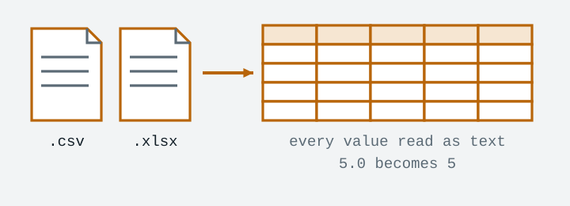

**B2. Sort headers: fixed / vertical / identity / skip**

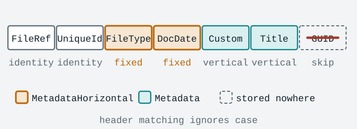

**B3. Filter: skip folders and old versions**

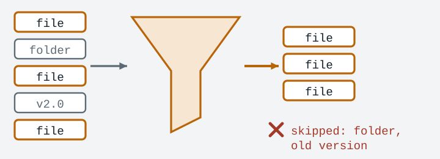

**B4. Stage: bulk copy into a temporary table**

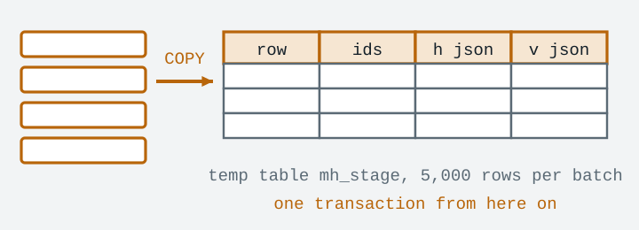

**B5. Match: four rules, first match wins**

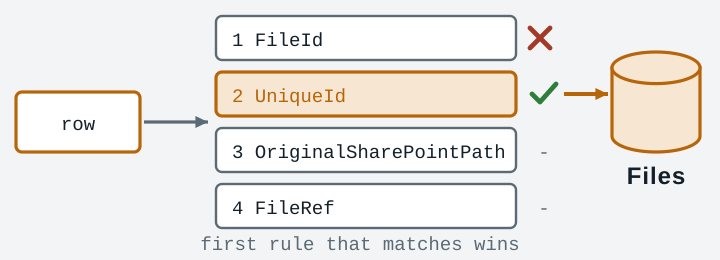

**B6. Horizontal: fixed keys become one row per file**

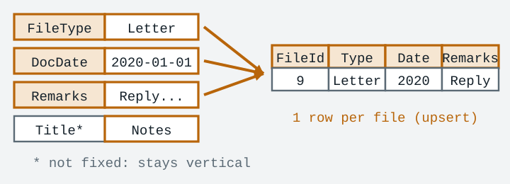

**B7. Vertical: replace the file's rows for the uploaded keys**

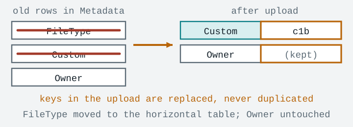

**B8. Commit: all or nothing, plus the unmatched report**


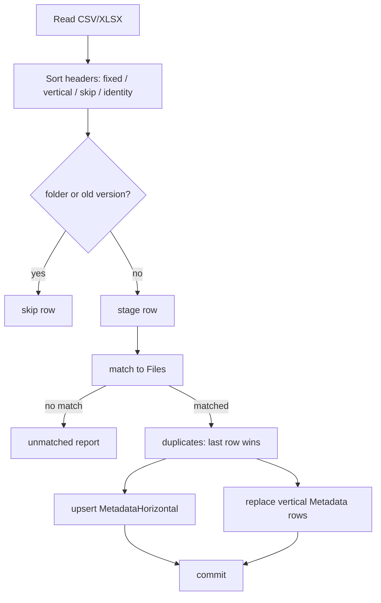

### B.3 The matching ladder

Each row is tried against these rules in order. The first rule that matches wins.

| # | Upload column | Matches `Files` by | Note |
|---|---|---|---|
| 1 | `FileId` | `FileId` | **Only if** the row's `UniqueId`, `OriginalSharePointPath` and `FileRef` (where present) agree with that file. The merge renumbered FileIds, so an old export's FileId may point to another file. |
| 2 | `UniqueId` | `SharePointUniqueId` | Braces and case don't matter. |
| 3 | `OriginalSharePointPath` | `OriginalSharePointPath` | Exact match. |
| 4 | `FileRef` | The path part of `OriginalSharePointPath` | `https://host` is removed before comparing. |

### B.4 Convert existing Metadata

This handles fields that are already in the vertical `Metadata` table (for example, from the phase3 scan). For each fixed key, the values are pivoted into one row per file, using the exact key name so the `MetadataKey` index is used. If you tick the checkbox, those keys are then deleted from `Metadata`.

### B.5 Table `MetadataHorizontal`

| Column | Notes |
|---|---|
| `MetadataHorizontalId` | serial PK |
| `FileId` | unique, FK → `Files` `ON DELETE CASCADE` |
| `SiteName` | Taken from the matched `Files` row (indexed). |
| `SiteId` | Only in the consolidated DB: indexed, FK → `Sites`, filled by the trigger. |
| *fixed columns* | `varchar(ColumnMaxLength)`. Each column's comment records its metadata key. |
| `SourceFile`, `ImportedAt`, `UpdatedAt` | Audit columns. |

---

## What was tested

| Area | Result |
|---|---|
| Consolidation, full run on 9 test DBs | `05_verify` OK, and a check of every parent/child link by name found 0 differences in 68 checks. |
| `SiteId` trigger | Covered inserts, a new site, `COPY`, a `SiteName` update, `claim_migration_tasks`, and the Parsed rebuild. |
| Metadata Horizontal logic | 25/25 checks: every matching rule, duplicates, re-upload, convert, cascade, and bad config. |
| Metadata Horizontal GUI | 12/12 checks: connect, sync, upload, convert, view, and the password never being saved. |

All tests ran on test data, not on the real databases.
